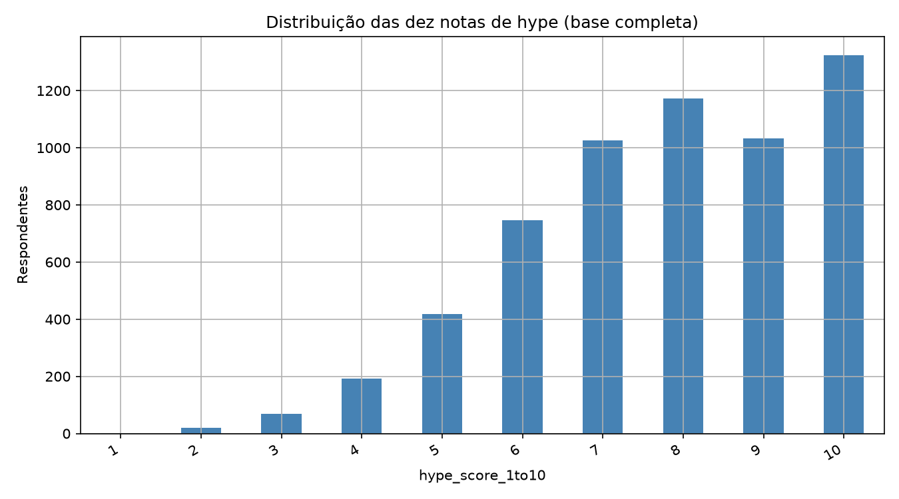
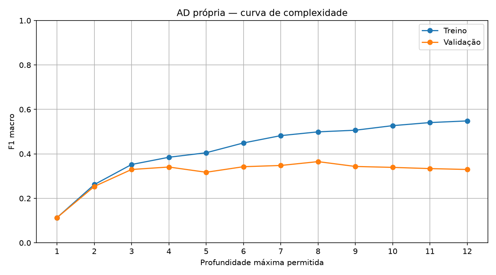

# Roteiro de apresentação — Classificação do hype de GTA VI

## Proposta da apresentação

- **Formato:** 18 slides principais e três slides de apoio para perguntas.
- **Duração sugerida:** 15 a 20 minutos, ajustável ao tempo da disciplina.
- **Público:** professor e turma de aprendizado de máquina.
- **Fonte principal:** [Gta6ClassificacaoTrabalho.ipynb](../../notebooks/Gta6ClassificacaoTrabalho.ipynb), com resultados já salvos no notebook, conferidos com os CSVs exportados.
- **Escopo:** este arquivo é um esquema para montar os slides, não uma apresentação `.pptx`. Não houve novo treinamento dos modelos para elaborar o roteiro.
- **Mensagem central:** nos três modelos selecionados antes do teste, a árvore própria obteve o maior F1 macro; a regressão logística Elastic Net obteve a maior acurácia. O desempenho continua limitado nas classes raras.

### Organização visual

Usar uma ideia central por slide, pouco texto e figuras grandes. Manter as mesmas cores para cada modelo e distinguir treino, validação e teste em títulos e legendas. Não colocar tabelas extensas nem código completo no corpo da apresentação. Os números com quatro casas são arredondamentos dos resultados exportados; F1 está na escala de 0 a 1 e acurácia está em porcentagem.

**Cuidados de linguagem:** apresentar o estudo como classificação de notas de hype em um questionário. Não chamar a base de corpus de comentários, não afirmar previsão do futuro, representatividade dos fãs ou aderência integral ao enunciado.

---

## Slide 01 — Classificação do hype de GTA VI

**Objetivo:** apresentar o problema e o recorte do trabalho.

**Conteúdo no slide:**
- Comparação entre regressão logística via SGD e árvore de decisão própria.
- Classificação multiclasse: notas de hype de 1 a 10.
- Nome dos integrantes, disciplina e professor: preencher na montagem.

**Visual:** capa simples com título e um fluxo curto: respostas do questionário → modelo → nota estimada.

**Fala sugerida:** “Investigamos a associação entre as respostas de um questionário e a nota de expectativa sobre GTA VI. Comparamos modelos lineares e uma árvore implementada do zero.”

---

## Slide 02 — Qual é a tarefa, exatamente?

**Mensagem:** prever uma classe de hype não é fazer análise de sentimento em texto livre.

**Conteúdo no slide:**
- Alvo: `hype_score_1to10`, preservando dez classes originais.
- Entradas: demais respostas, exceto `respondent_id`.
- `overall_sentiment` tem três categorias e permanece como atributo.
- As respostas são contemporâneas: não há previsão temporal ou causal.

**Visual:** separar “alvo”, “atributos” e “fora do escopo”.

**Fala sugerida:** “Não agrupamos nem inventamos classes. A nota é o alvo; sentimento e plataforma são atributos. O modelo estima uma resposta a partir de outras respostas do mesmo questionário.”

---

## Slide 03 — Base de dados e qualidade

**Conteúdo no slide:**
- Arquivo: `gta6_fan_expectations_2026.csv`.
- 6.000 registros e 20 colunas; identificadores únicos.
- Sem linhas duplicadas, inclusive ao desconsiderar o identificador.
- Ausências: `gender`, 60 registros (1%); `willingness_to_pay_usd`, 120 registros (2%).

**Visual:** cartões com os principais números e exemplos de campos: idade, plataforma, visualizações do trailer, intenção de compra e confiança na Rockstar.

**Nota de fala:** “A estrutura permite um estudo tabular, mas o arquivo não comprova origem, licença, autenticidade ou representatividade da coleta.”

**Evidência:** [auditoria de colunas](resultados/auditoria_colunas.csv); estudo introdutório do notebook.

---

## Slide 04 — O desafio: classes desbalanceadas

**Conteúdo no slide:**
- 75,88% dos registros têm notas de 7 a 10.
- Nota 10: 1.324 registros, a classe mais frequente.
- Nota 1: apenas dois registros.
- Acurácia isolada pode esconder o desempenho por classe.

**Visual principal:**

**Fala sugerida:** “Acertar as notas frequentes não significa reconhecer todas as classes. Por isso, o F1 macro é central na seleção e na interpretação.”

**Evidência:** [distribuição de classes](resultados/distribuicao_classes.csv). A porcentagem foi calculada a partir dessas contagens.

---

## Slide 05 — Divisão dos dados e proteção do teste

**Conteúdo no slide:**
- Treino: 3.600 registros (60%).
- Validação: 1.200 (20%); teste: 1.200 (20%).
- Estratificação nas classes com suporte suficiente e IDs disjuntos.
- Nota 1: um exemplo no treino, um no teste e nenhum na validação.

**Visual:** barra 60/20/20 com a classe rara destacada em uma observação.

**Fala sugerida:** “A nota 1 não pode ocupar três conjuntos sem duplicação. A exceção é explícita. O teste só é consultado depois de congelar a seleção.”

**Ressalva:** o F1 macro considera as dez classes, com zero para a classe ausente na validação; a avaliação da nota 1 é extremamente frágil.

**Evidência:** [partições por classe](resultados/particoes_por_classe.csv).

---

## Slide 06 — Transformação das respostas em atributos

**Conteúdo no slide:**
- Numéricos: imputação pela mediana e padronização.
- Categóricos: categoria de ausência e codificação one-hot.
- Descrições: TF-IDF com unigramas e bigramas.
- Demonstração com treino completo: 109 atributos, sendo 57 termos TF-IDF.

**Visual:** três caminhos de transformação convergindo na mesma matriz fornecida aos dois algoritmos.

**Fala sugerida:** “Cada subconjunto ajusta o próprio pré-processador. Vocabulário, IDF, medianas e escalas não são aprendidos com validação ou teste.”

**Ressalva no rodapé:** `most_anticipated_feature` possui dez opções predefinidas; TF-IDF aqui representa categorias lexicalmente, não comentários livres. Não foi medido o ganho isolado do TF-IDF.

---

## Slide 07 — Regressão logística via SGD

**Conteúdo no slide:**
- `SGDClassifier(loss='log_loss')`, estratégia um-contra-resto (OvR).
- Quatro variantes: sem penalidade, L2/Ridge, L1/Lasso e Elastic Net.
- 160 épocas; taxa inicial 0,01; `alpha=0,001` nas variantes regularizadas.
- Elastic Net: combinação 50% L1 e 50% L2.

**Visual:** quatro colunas curtas, uma por penalidade.

**Fala sugerida:** “A regressão logística foi treinada com gradiente descendente estocástico. Não usamos softmax multinomial nem apresentamos RidgeClassifier como regressão logística.”

**Nota:** hiperparâmetros fixos, sem busca; o orçamento de épocas não prova convergência. Se a disciplina exigir GD em lote, confirmar a aceitação de SGD.

---

## Slide 08 — Árvore de decisão implementada do zero

**Conteúdo no slide:**
- CART binária multiclasse com impureza Gini.
- Busca exata de cortes entre valores distintos dos atributos.
- Treinamento, percurso e predição próprios, sem `sklearn.tree`.
- Mínimo de oito amostras por folha; curva de profundidades de 1 a 12.

**Visual:** desenho genérico de nó → corte → duas folhas, identificado como ilustração, não como árvore extraída da execução.

**Fala sugerida:** “Em cada nó, o algoritmo procura a maior redução de impureza. A profundidade limita a complexidade. A representação é a mesma da regressão logística, mas a árvore a converte para matriz densa.”

---

## Slide 09 — Desenho experimental e métricas

**Conteúdo no slide:**
- 81 modelos treinados: curvas LR, consistência AD e profundidades AD.
- Sementes 42, 43 e 44, com divisão principal fixa.
- F1 macro: cada classe tem o mesmo peso.
- F1 micro = acurácia neste problema de rótulo único.

**Visual:** matriz resumida dos experimentos; reservar a decomposição completa para o apoio.

**Fala sugerida:** “As repetições avaliam sensibilidade à amostragem e ao SGD. Não são três divisões independentes nem validação cruzada. Todos os modelos foram avaliados no teste apenas depois da seleção.”

---

## Slide 10 — Curvas de aprendizado da regressão logística

**Conteúdo no slide:**
- Treinos com 360, 1.080, 2.160, 3.240 e 3.600 exemplos.
- Curvas mostram média e um desvio-padrão de três sementes.
- Entre os extremos, todas as variantes melhoraram o F1 macro médio de validação.

| Variante | Validação: 360 exemplos | Validação: 3.600 exemplos |
|---|---:|---:|
| Sem regularização | 0,2701 | 0,3378 |
| Ridge | 0,2690 | 0,3384 |
| Lasso | 0,2712 | 0,3376 |
| Elastic Net | 0,2703 | 0,3409 |

**Visual:** montar uma grade 2 × 2 usando as figuras abaixo; a tabela serve como referência e pode ficar apenas nas notas se prejudicar a legibilidade.

- [Curva 1 — sem regularização](resultados/figuras/curva_1_lr.png)
- [Curva 2 — Ridge](resultados/figuras/curva_2_lr.png)
- [Curva 3 — Lasso](resultados/figuras/curva_3_lr.png)
- [Curva 4 — Elastic Net](resultados/figuras/curva_4_lr.png)

**Fala sugerida:** “O maior conjunto trouxe ganho em relação ao menor, mas as diferenças entre penalidades são pequenas. Isso não prova melhoria monotônica nem superioridade estatística.”

---

## Slide 11 — Profundidade da árvore e sobreajuste

**Conteúdo no slide:**
- Maior F1 macro de validação na curva: profundidade 8, com 0,3653.
- Profundidade 8: F1 macro de treino 0,4992 e 253 nós.
- Profundidade 12: treino 0,5484; validação 0,3300.
- Aumentar a profundidade após o ponto selecionado não trouxe melhor validação.

**Visual principal:**

**Fala sugerida:** “O treino continua melhorando, mas a validação cai nas maiores profundidades. O padrão é compatível com sobreajuste; a árvore mais profunda não foi selecionada.”

**Nota:** o eixo X é profundidade, não quantidade de exemplos. O treino permanece completo.

---

## Slide 12 — Consistência com 30%, 60% e 90% do treino

**Conteúdo no slide:** F1 macro de validação, média ± desvio-padrão amostral.

| Parcela do treino | Registros | LR Ridge | AD própria, profundidade 8 |
|---|---:|---:|---:|
| 30% | 1.080 | 0,3245 ± 0,0057 | 0,3563 ± 0,0115 |
| 60% | 2.160 | 0,3335 ± 0,0034 | 0,3713 ± 0,0194 |
| 90% | 3.240 | 0,3378 ± 0,0060 | 0,3694 ± 0,0073 |

**Visual:** tabela ou gráfico de linhas com barras de desvio, a montar a partir do CSV.

**Fala sugerida:** “A árvore superou Ridge nos nove pares de semente e tamanho observados. Com 90%, não superou sua própria média de 60%. Três sementes não bastam para alegar significância ou generalização populacional.”

**Nota:** porcentagens da partição de treino, não da base inteira. Os subconjuntos são aninhados e pareados entre algoritmos.

**Evidência:** [resumo](resultados/consistencia_resumo.csv) e [comparação pareada](resultados/consistencia_pareada.csv).

---

## Slide 13 — Como os três modelos foram selecionados

| Configuração | Critério anterior ao teste | F1 macro de validação, semente 42 |
|---|---|---:|
| LR sem regularização | Referência sem penalidade | 0,3383 |
| LR Elastic Net | Melhor família regularizada pela média das três sementes | 0,3408 |
| AD própria, profundidade 8 | Melhor profundidade pela validação | 0,3653 |

**Visual:** seta “validação → seleção congelada → teste”.

**Fala sugerida:** “Não escolhemos os três maiores resultados no teste. As duas LR usam todo o treino e a semente 42, sem procurar a melhor semente. A média de validação da família Elastic Net foi 0,3409.”

**Nota:** não houve retreino juntando treino e validação.

**Evidência:** [seleção antes do teste](resultados/selecao_antes_teste.csv).

---

## Slide 14 — Resultados finais no teste

**Mensagem:** a escolha da métrica muda a comparação entre os selecionados.

| Modelo | Precisão macro | Recall macro | F1 macro | Acurácia / F1 micro |
|---|---:|---:|---:|---:|
| Baseline majoritário | 0,0221 | 0,1000 | 0,0362 | 22,08% |
| LR sem regularização | 0,3490 | 0,3808 | 0,3474 | 52,25% |
| LR Elastic Net | 0,3594 | 0,3848 | 0,3508 | 53,33% |
| AD própria, profundidade 8 | 0,3854 | 0,3980 | 0,3876 | 48,67% |

**Visual:** destacar a coluna F1 macro da árvore e a acurácia da Elastic Net. Na montagem, simplificar a tabela se necessário; não misturar escalas num mesmo eixo.

**Fala sugerida:** “Todos superam o baseline que sempre prevê a nota 10. Entre os selecionados, Elastic Net tem mais acertos globais; a árvore apresenta maior F1 macro. Não há um vencedor único sem definir o objetivo.”

**Nota:** resultados individuais da semente 42, não médias de três sementes.

**Evidência:** [métricas de todos os casos](resultados/metricas_teste_todos_casos.csv) e [baseline](resultados/baseline_teste.csv).

---

## Slide 15 — O que as matrizes de confusão revelam?

**Conteúdo no slide:**
- LR sem regularização: nota 9 confundida com 10 em 97 casos e com 8 em 95.
- Elastic Net: nota 9 confundida com 10 em 94 casos e com 8 em 93.
- AD: nota 9 confundida com 8 em 77 casos e com 10 em 74.

**Visual:** três matrizes lado a lado, com a mesma ordem de classes; realçar a linha da nota 9. Se o texto ficar pequeno, ampliar a matriz da árvore e deixar as outras no apoio.

- [Matriz 1 — LR sem regularização](resultados/figuras/matriz_confusao_1.png)
- [Matriz 2 — LR Elastic Net](resultados/figuras/matriz_confusao_2.png)
- [Matriz 3 — AD própria](resultados/figuras/matriz_confusao_3.png)

**Fala sugerida:** “Há confusões importantes entre notas vizinhas, mas elas não desaparecem. As contagens precisam ser lidas junto com o recall por classe.”

---

## Slide 16 — Classes raras e diferenças entre modelos

**Conteúdo no slide:** recall no teste.

| Nota | Suporte | LR sem regularização | Elastic Net | AD própria |
|---|---:|---:|---:|---:|
| 1 | 1 | 0,00% | 0,00% | 0,00% |
| 2 | 4 | 0,00% | 0,00% | 0,00% |
| 3 | 14 | 0,00% | 0,00% | 57,14% |
| 9 | 206 | 6,80% | 9,22% | 26,70% |
| 10 | 265 | 69,06% | 70,94% | 53,96% |

**Visual:** tabela compacta; destacar o suporte pequeno das primeiras classes.

**Fala sugerida:** “A árvore recupera parte das notas 3 e mais notas 9, mas tem recall menor na nota 10. O maior F1 macro não significa ser melhor em todas as classes. Nenhum selecionado acerta as notas 1 e 2.”

**Evidência:** [relatórios por classe](resultados/metricas_teste_por_classe.csv) e matrizes normalizadas em `resultados/`.

---

## Slide 17 — Limitações e aderência ao enunciado

**Conteúdo no slide:**
- Não há texto livre: TF-IDF sobre dez frases categóricas não resolve essa exigência.
- Fonte, licença e representatividade não comprovadas pelo CSV.
- `overall_sentiment` pode ser derivado da nota: risco de vazamento semântico não descartado.
- Holdout único, três sementes e hiperparâmetros fixos limitam as conclusões.

**Visual:** dois blocos: “o protocolo controla” e “o que permanece sem comprovação”.

**Fala sugerida:** “Separar as partições protege o ajuste estatístico, mas não resolve a origem dos atributos. É necessário verificar a proveniência do sentimento e obter autorização para a adaptação ou dados textuais reais.”

**Nota adicional:** as notas são ordinais, mas os modelos tratam as dez classes como rótulos multiclasse; o protocolo não mede a distância entre os erros.

---

## Slide 18 — Conclusões e próximos passos

**Conteúdo no slide:**
1. A comparação é viável no questionário: os selecionados superam o baseline.
2. AD própria: maior F1 macro entre os selecionados; Elastic Net: maior acurácia.
3. Persistem sobreajuste na árvore e falhas nas classes raras.
4. Próximos passos: auditar a origem dos dados, testar sem sentimento e avaliar dados/classes mais bem representados.

**Visual:** três resultados centrais e uma faixa com as propostas futuras.

**Fala de encerramento:** “O resultado principal não é uma acurácia isolada, mas a diferença entre acertar mais no total e distribuir melhor o desempenho entre classes. O estudo permanece uma adaptação tabular com limitações explícitas.”

**Propostas ainda não executadas:** ablação sem `overall_sentiment`, comparação TF-IDF versus one-hot para as descrições, busca de hiperparâmetros restrita ao desenvolvimento e abordagem ordinal. Havendo nova seleção após examinar estes resultados, reservar um teste final independente.

---

## Apoio A — Distribuição completa das classes

| Nota | Base inteira | Treino | Validação | Teste |
|---|---:|---:|---:|---:|
| 1 | 2 | 1 | 0 | 1 |
| 2 | 19 | 11 | 4 | 4 |
| 3 | 69 | 41 | 14 | 14 |
| 4 | 192 | 116 | 38 | 38 |
| 5 | 419 | 251 | 84 | 84 |
| 6 | 746 | 448 | 149 | 149 |
| 7 | 1.025 | 615 | 205 | 205 |
| 8 | 1.172 | 703 | 235 | 234 |
| 9 | 1.032 | 620 | 206 | 206 |
| 10 | 1.324 | 794 | 265 | 265 |
| Total | 6.000 | 3.600 | 1.200 | 1.200 |

**Resposta preparada:** “O caso da nota 1 é uma restrição real de suporte; não foi corrigido duplicando dados ou inventando classes.”

---

## Apoio B — Experimentos e generalização

### Composição dos 81 modelos

- Curvas LR: quatro variantes × cinco tamanhos × três sementes = 60.
- Consistência AD: três tamanhos × três sementes = nove.
- Curva AD: 12 profundidades = 12.
- As nove linhas de Ridge usadas na consistência já fazem parte das curvas LR.

### Gap de F1 macro entre treino e validação, selecionados

| Modelo | Treino | Validação | Gap |
|---|---:|---:|---:|
| LR sem regularização | 0,3810 | 0,3383 | 0,0427 |
| Elastic Net | 0,3706 | 0,3408 | 0,0299 |
| AD, profundidade 8 | 0,4992 | 0,3653 | 0,1339 |

**Resposta preparada:** “A regularização Elastic Net reduziu o gap observado em relação à LR sem penalidade. Isso não prova uma vantagem geral, pois alpha não foi otimizado e não houve teste de significância.”

**Cuidado:** a árvore de profundidade 7 chegou a F1 macro de teste 0,4010, mas não foi a selecionada pela validação. Esse resultado é descritivo e não autoriza trocar o modelo após olhar o teste.

---

## Apoio C — Perguntas prováveis e respostas curtas

**Por que não usar sentimento como alvo?**
Porque o campo tem três categorias. O trabalho preservou as dez notas nativas de hype, sem fabricar rótulos.

**O trabalho atende totalmente ao enunciado?**
Não. Falta texto genuinamente não estruturado; também é preciso confirmar SGD se GD em lote for obrigatório.

**Qual modelo é o melhor?**
Entre os três selecionados, a AD tem maior F1 macro e Elastic Net maior acurácia. A resposta depende da métrica e do uso, sem extrapolar para outros dados.

**A árvore ganhou por causa do TF-IDF?**
Não é possível afirmar. Não foi realizada ablação que isole o efeito do texto, das categorias ou do sentimento.

**Mais dados resolveram o problema?**
O maior treino melhorou as médias LR em relação ao menor, mas não resolveu as classes raras nem trouxe melhora monotônica em todos os experimentos.

**Há vazamento?**
O pré-processamento foi ajustado somente no treino e a seleção antecedeu o teste. Isso não descarta vazamento semântico: a origem de `overall_sentiment` precisa ser auditada.

**Como reproduzir e localizar as evidências?**
Consultar o [README](README.md), o [relatório](resultados/relatorio_resultados.md), o [manifesto](resultados/manifesto.json), as tabelas e as figuras. Este roteiro descreve os resultados existentes; não substitui a validação científica da coleta.

---

## Checklist para montar a apresentação

- [ ] Preencher nomes, disciplina e professor sem inventar informações.
- [ ] Conferir o limite de tempo e reduzir conteúdo visual se necessário.
- [ ] Usar os gráficos exportados, sem screenshots de código ou imagens base64.
- [ ] Identificar se cada tabela representa treino, validação ou teste.
- [ ] Não confundir percentuais de treino com percentuais da base inteira.
- [ ] Não misturar médias entre sementes com o resultado individual da semente 42.
- [ ] Manter visíveis as ressalvas sobre texto categórico e classe rara.
- [ ] Não apresentar o melhor resultado de teste como seleção por validação.
- [ ] Separar experimentos executados de próximos passos propostos.
- [ ] Encerrar sem afirmar previsão temporal, causalidade ou representatividade populacional.
